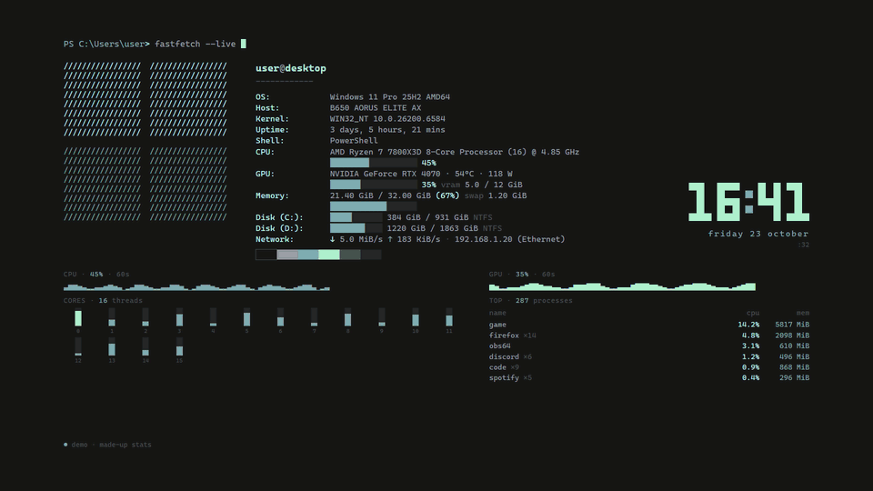
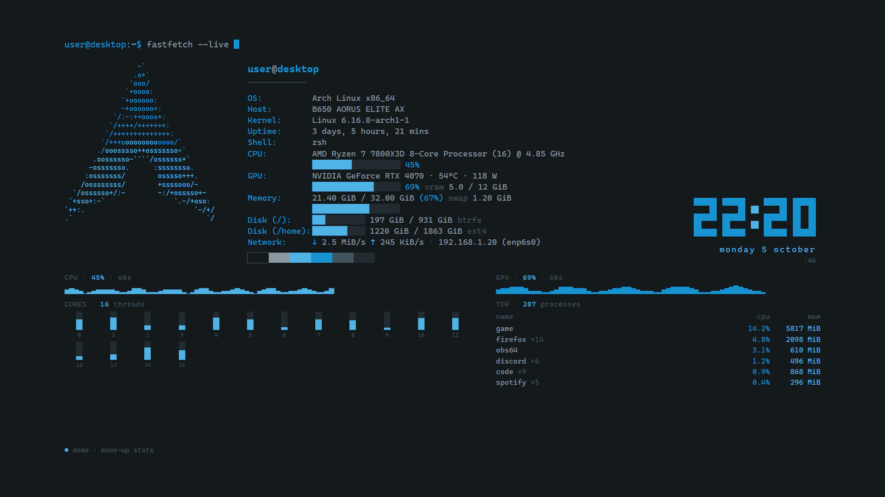
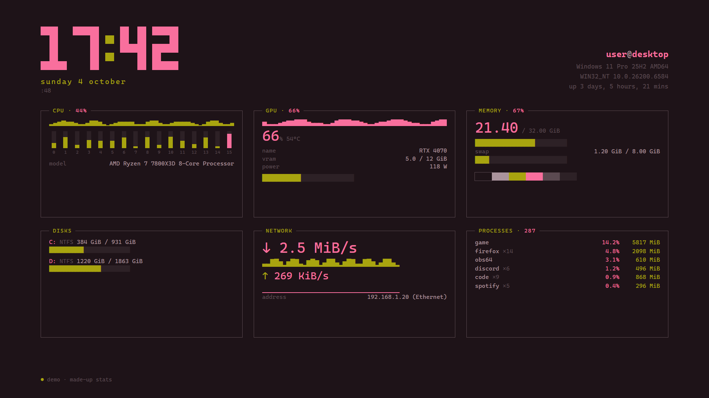
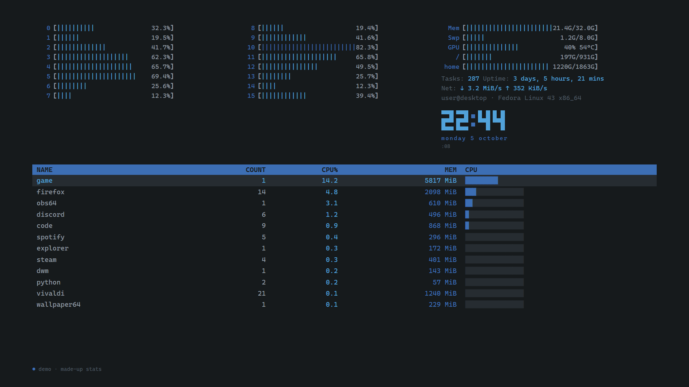
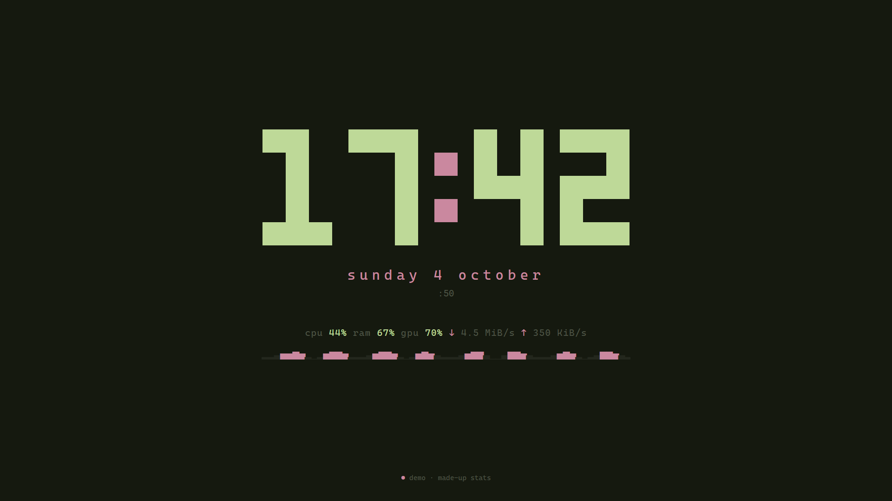
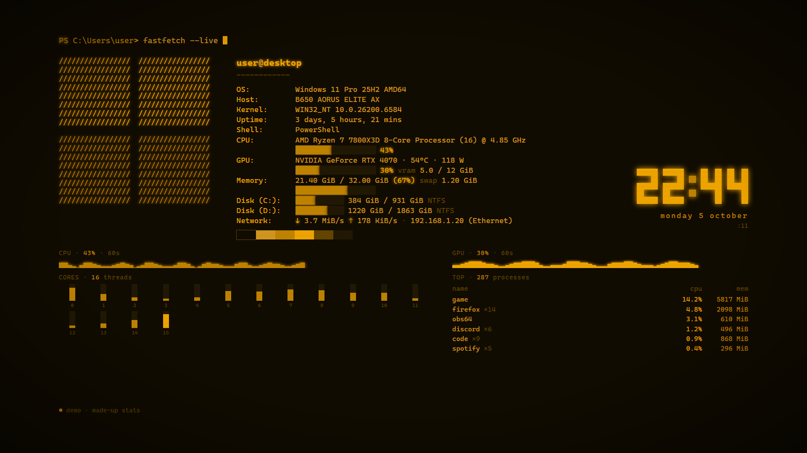
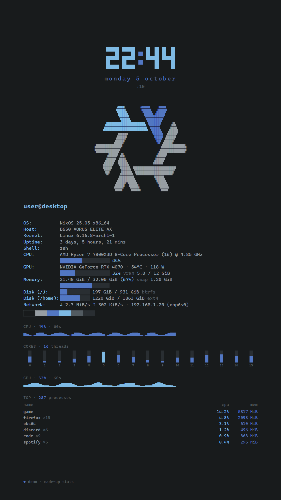
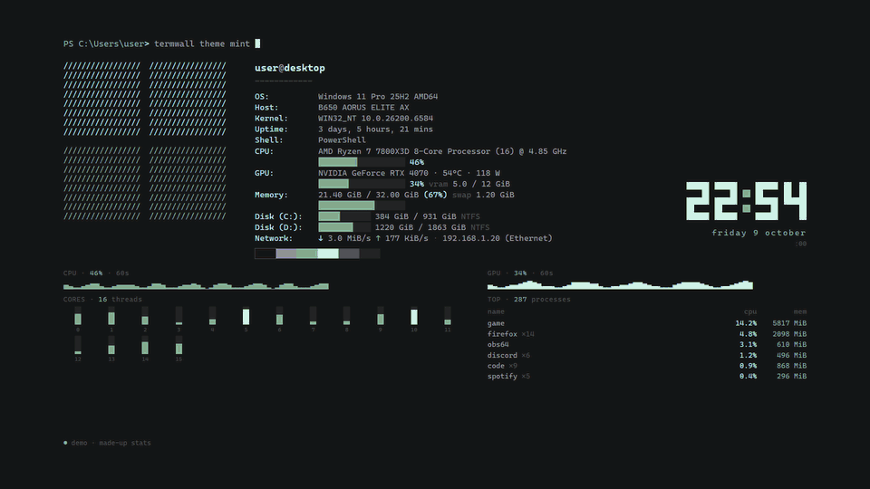
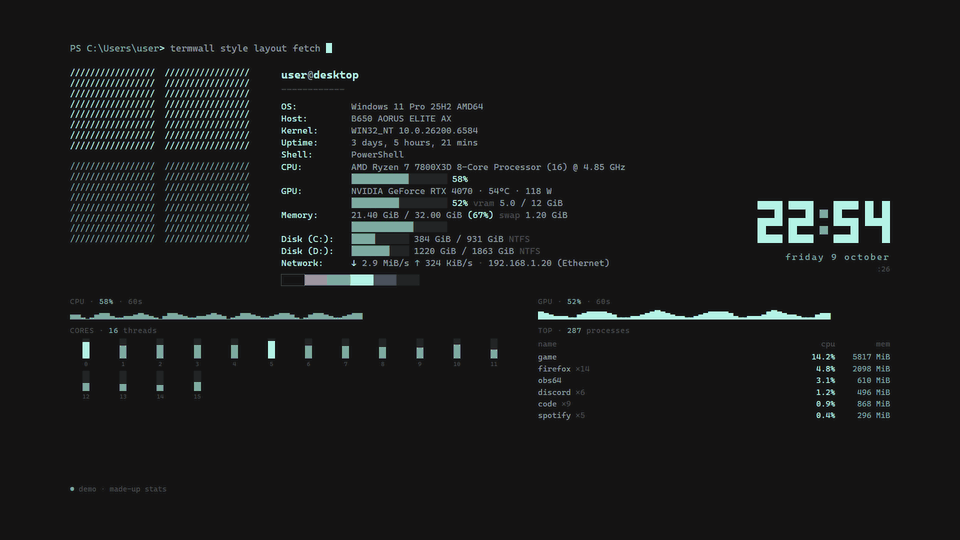

# termwall

A live system-stats wallpaper in the style of [fastfetch](https://github.com/fastfetch-cli/fastfetch):
system info, per-core CPU, CPU and GPU history, memory, disks, network and top processes,
refreshed every second. Seven layouts, fourteen built-in themes, all 540 of fastfetch's logos (Linux,
macOS, ChromeOS, Windows 95 to 11, the BSDs; or your own picture or GIF) in their own colors, CRT effects, a different look on each monitor, one commented
settings file, and a palette that can follow your wallpaper.



| fetch | board | htop |
|---|---|---|
|  |  |  |

| minimal | the amber theme with `effects crt,glow` | portrait |
|---|---|---|
|  |  |  |

Fourteen themes:



Layouts, bars, fonts, effects and the other settings:



The pictures come from the demo mode (`index.html?demo`) with made-up stats;
`tools/make_gifs.py` rebuilds the GIFs.

## Requirements

- **Windows 10 or 11**, 64-bit.
- **Something that shows a web page as a wallpaper**: [Lively Wallpaper](https://github.com/rocksdanister/lively)
  (free, open source: `winget install rocksdanister.LivelyWallpaper`) or
  [Wallpaper Engine](https://store.steampowered.com/app/431960/) (paid, Steam). termwall is
  the page; one of these puts it on the desktop.
- Linux: Wayland compositors with layer-shell (Hyprland, Sway, KDE Plasma, ...), experimental.
  See [Linux](#linux-experimental).

## Install

Download `termwall-setup-X.Y.Z.exe` from [Releases](https://github.com/PantoYT/termwall/releases)
and run it. No admin rights, nothing else to install.

- Installs to `%LOCALAPPDATA%\Programs\termwall` with its own Python.
- Starts the stats server now and at every logon.
- Adds termwall to Wallpaper Engine (a link in `projects\myprojects`) and to Lively's library,
  whichever you have. In Lively, restart it once to see termwall in the library.
- Uninstall: Windows' Apps list. It stops the server and removes the autostart and both
  links.

A winget package is in review; once it's accepted: `winget install PantoYT.termwall`.

**Updating**: `termwall update` looks up the latest release on GitHub, downloads the installer,
checks it against the release's SHA-256 and runs it in the background; your `termwall.toml`
stays. `termwall update --check` only tells you whether there is one, and `termwall version`
mentions a newer release too. termwall never checks on its own. Running a newer installer by
hand does the same thing; a git clone updates with `git pull`.

The installer also puts a `termwall` command on your PATH (in new terminals):
`termwall config` (opens the settings file), `termwall --style layout board`, `termwall --version`.

## Configuration

termwall reads two optional files from its folder (`%LOCALAPPDATA%\Programs\termwall` after
the installer, the repo folder otherwise). Both are picked up within a second, without
reloading the wallpaper.

**The look**: `termwall.toml`. `termwall config` opens it in an editor (`$EDITOR`, else the app
set for `.toml` files, else VS Code, else Notepad): every setting is in it with its
current value, and the comment above each one says what it does and what it accepts. Change a
value, save, and the wallpaper follows. `termwall check` names a line termwall can't use, and a
setting a switcher's `theme.json` overrides for the current wallpaper (an
invalid value falls back to its default; a file that isn't valid TOML keeps the last good
settings until it's fixed). From the command line instead: `termwall --style KEY VALUE`
(`termwall --style` alone lists everything, `KEY default` puts one back, `reset` all of them).
A `termwall.json` from termwall 1.1 is carried over on the first start and renamed to
`termwall.json.old`.

| setting | values | default |
|---|---|---|
| `layout` | `fetch` (fastfetch), `board` (boxes, like btop), `htop` (meters and a big process table), `minimal` (the clock and one line), `portrait` (for a monitor on its side), `phone` (big gauges for a phone; `termwall share` picks it when the phone is upright), `logo` (the logo as big as the screen, with user, system and the palette under it) | `fetch` |
| `theme` | `auto`, `logo` (the logo's colors over everything: a picture's own with `logo = "image"`, else the shown distro's, also on Windows; `distro` is the same), `mint`, `catppuccin`, `gruvbox`, `nord`, `dracula`, `tokyo-night`, `rose-pine`, `everforest`, `kanagawa`, `solarized`, `one-dark`, `monokai`, `amber`, `phosphor` (`termwall --themes`, or `termwall --theme nord`) | `auto`: livery's palette if it runs, else the logo's colors, else mint |
| `colors` | your own six colors: uncomment the `colors = { bg = "#…", … }` line in `termwall.toml` | |
| `bars` | `blocks`, `shade`, `dots`, `line` | `blocks` |
| `hide` | any of `prompt`, `logo`, `info`, `clock`, `cpu`, `cores`, `gpu`, `memory`, `disks`, `network`, `procs`, `swatches`, `music`, `status` (`termwall --style hide gpu,procs`; `none` shows all) | nothing |
| `clock` | `24h`, `12h` | `24h` |
| `seconds` | `true`, `false` (`on`/`off` with `--style`) | `true` |
| `date` | `long` (monday 5 october), `short`, `iso`, `none` | `long` |
| `prompt` | the command in the prompt line, any text up to 60 characters | `fastfetch --live` |
| `private` | `true` hides your user name, computer name and local IP (for streams and screenshots) | `false` |
| `logo` | `auto`, `windows`, `tux`, `none`, `image` (see below), `custom` (your own ASCII art from `logo.txt` next to `termwall.toml`: up to 40 lines, `$1` accent, `$2` secondary, `$3` text, `$4` dim switch the color, or your own colors through `logo_colors`; `termwall logo-from PICTURE` makes one from a picture, see below), or any of fastfetch's 540 logos by id (`arch` on Windows works; `termwall logos` lists them, `termwall logos mac` finds the macOS ones, `termwall logos apple` shows one in the terminal) | `auto` |
| `logo_width`, `logo_chars`, `logo_colors` | with `logo = "image"`: a picture or an animated GIF (`logo.gif`, `.png`, `.jpg` or `.webp` next to `termwall.toml`, up to 8 MB) turned into text. `logo_width` 12-120 characters; `logo_chars` `blocks` (half blocks, two pixels per character, best for pixel art) or `ascii`; GIF frames play at their own speed | `40`, `blocks` |
| `logo_colors` | the logo's colors, separate from the rest of the screen (theme, livery and `colors` don't change): `own` (fastfetch's own colors, so `apple` is a rainbow; a picture's own), `palette` (the palette's; a picture's light and dark turned into it), a list of up to nine `#rrggbb` for `$1`, `$2`... of a text logo (`["#e05252", "#5fb85f"]`, or `termwall --style logo_colors "#e05252,#5fb85f"`), `auto` (a picture in its own colors, text logos in the palette; `image` is the same) | `auto` |
| `prompt_color` | `text`, `accent`, `secondary`, `dim`: the color of the command in the prompt line | `text` |
| `font` | `cascadia` (comes with Windows 11), `jetbrains`, `fira`, `iosevka` (these three come with termwall), `consolas`, `system` (the browser's monospace) | `cascadia` |
| `scale` | `0.8` to `1.1`: smaller fits more, larger makes everything bigger | `1.0` |
| `effects` | any mix of `crt` (scanlines and a vignette), `glow` (soft light around text), `flicker` (faint unsteady brightness), `roll` (a slow band rolling down), `chroma` (red/cyan fringes), `curve` (rounded tube corners), `noise` (film grain) | none |
| `rotate` | minutes between layouts, `0` = off | `0` |

**A logo from a picture**: `termwall logo-from flag.png` turns a picture into `logo.txt`
(fastfetch's format: `$1`…`$9` switch the color) and sets `logo = "custom"` with the
picture's colors in `logo_colors`, so you can edit the text by hand, share it, or send it to
fastfetch. Up to nine colors, the most used one `$1`. A plain background around the picture
goes, and so do the colors where it blended into the edges; a background-colored detail
inside the picture stays. Half blocks by default, two pixels a character; a character has one
color, so where two differ the rarer one wins (lines and highlights survive). Options:
`--width N` (40), `--ascii` (characters from light to dense), `--colors N`, `--keep-bg`,
`--out FILE` (write only that file, settings untouched), `--force` (replace `logo.txt`).
PNG is read with the standard library; GIF (its first frame), JPEG, WebP and BMP need Pillow
(`pip install pillow`). For a picture that moves or that you don't want to edit,
`logo = "image"` draws it live instead.

**The palette**: `theme.json`, six `#rrggbb` colors:

```json
{"bg": "#171717", "accent": "#b5f4e7", "secondary": "#7faca3",
 "text": "#939fa1", "dim": "#4b5252", "faint": "#242626"}
```

A wallpaper switcher writes this file on every switch:
[livery](https://github.com/PantoYT/livery) (also by me) changes the wallpaper and recolors
Discord, Spotify, browsers, RGB and termwall in one keypress. termwall uses its palette while
`theme` is `auto` and `colors` isn't set; pick a theme or your own colors and those win. It may also carry a
`"style"` object (`{"layout": "minimal"}`) with any of the settings above, so each palette
can have its own look.

**What wins**, highest first:

| source | sets | applies |
|---|---|---|
| URL `?layout=…&hide=…&effects=…` and the other settings | the look | always (handy in a browser) |
| URL `?demo&bg=…&accent=…` (all six) | palette | demo mode only |
| `"style"` in `theme.json` | the look | always |
| `termwall.toml` | the look | always |
| `colors` in `termwall.toml` | colors | always |
| `theme` in `termwall.toml` | colors | unless it's `auto` |
| `theme.json` palette (livery) | colors | with `theme` auto and no `colors` |
| your distro's colors | colors | Linux, `theme` auto |
| built-in defaults | everything | otherwise |

`TERMWALL_THEME` and `TERMWALL_STYLE` (environment variables) point the server at other
files. The port, `127.0.0.1:9002`, is fixed.

## Several monitors

Each monitor can look different (Wallpaper Engine): put termwall on every monitor ("one
wallpaper per display"), click it on a monitor and set its **termwall screen** property to a
number. Then, at the end of `termwall.toml`:

```toml
[screen.2]
layout = "logo"
effects = ["crt"]
```

A `[screen.N]` table changes only the settings it names, for that monitor; the rest come from
the main settings. It also wins over livery's per-pack look. Lively Wallpaper has no such
property yet: there every monitor shows screen 1.

## On a phone (experimental)

This works, but it's a first version: pull requests welcome. Known gaps:

- the `phone` layout is a first draft: spacing, sizes and what it shows could all be better,
  and it's only been tried on one Android phone;
- over plain HTTP the browser won't keep the screen on and the home-screen icon opens a normal
  tab (HTTPS, e.g. through Tailscale's certificates, would fix both);
- Wallpaper Engine's Android app doesn't take web wallpapers, so termwall can't be the phone's
  own wallpaper yet; a small Android live-wallpaper app wrapping a WebView would do it.

```
termwall share
```

prints a QR code and a link. Scan it with a phone on the same Wi-Fi, then use the browser's
menu: **Add to Home screen**. From then on the icon opens termwall full screen whenever the PC
runs: upright the phone shows the phone layout (big gauges, network, disks, the top five), sideways your usual one, in the same colors
and effects. A tap goes full screen.

- It's a second, read-only server on your network (port 9012), started and stopped by
  `termwall share` / `termwall share off` while termwall runs; it stays on across restarts
  until you turn it off.
- The link carries a random key (in `share.json`). `termwall share new-key` replaces it; links
  and home-screen icons made before stop working. 20 wrong keys from one address block it for
  10 minutes.
- Your user name, computer name and IP never go out on it: private mode is forced, and the
  server removes them before sending, not only the page.
- The Host header has to be an IP address, so a web page can't reach it through a DNS name.
- With [Tailscale](https://tailscale.com) on the PC and the phone, the 100.x link it prints
  works away from home too.
- Windows Firewall asks once whether Python may listen on private networks: allow it, or the
  phone can't connect (Windows Security > Firewall & network protection > Allow an app).
- Plain HTTP on a home network means the browser won't keep the screen on by itself: set the
  phone's screen timeout, or Android's "Stay awake" (developer options) while it charges.

## Troubleshooting

| problem | what to check |
|---|---|
| the wallpaper is empty, "api offline" at the bottom | the stats server isn't running: start it (`termwall-api.vbs`, or log off and on after the installer). Check it with `http://127.0.0.1:9002/health` in a browser: it shows the version and request counters when it runs (`/stats` itself answers `403` in a browser, that's the token below, not an error) |
| the server won't start: "port 9002 is taken" | another termwall is already running (a manual one next to the installed one?) |
| GPU shows `n/a` | only NVIDIA cards are read (through `nvidia-smi`); AMD and Intel GPUs show `n/a` |
| Wallpaper Engine shows an old version after an update | WE plays its own copy of termwall: use the installer, or a junction ([Manual setup](#manual-setup)) |
| colors or layout don't change | `termwall check` names a line in `termwall.toml` it can't use. Is there a `theme.json`? Its colors and `"style"` win |

## How it works

A browser can't read CPU or GPU usage, so termwall has two halves: the page (`index.html`)
and a small local server (`termwall_api.py`, "the server" in this README) that the page asks
once a second.

| file | what it is |
|---|---|
| `index.html` | the wallpaper: one page, no dependencies |
| `logos.js` | distro logos (from fastfetch, see [Credits](#credits)) |
| `termwall_api.py` | the server: psutil for the stats, `nvidia-smi` for an NVIDIA GPU |
| `termwall-api.vbs` | starts the server without a console window (manual setup) |
| `project.json` | Wallpaper Engine's project file |

The server samples in the background (every second; GPU every 2 s, processes every 3 s), so
a request never waits. Endpoints: `/stats` (everything), `/theme` (palette and look only,
polled four times a second so a palette switch lands fast), `/health` (version and request
counters, the only one without the token).

`/stats`, shortened from a real `--once` (sizes in bytes, rates in bytes/s, `cpu_freq`
and GPU clock in MHz, `vram_*` in MiB, `uptime` in seconds, percentages 0-100):

```json
{"user": "…", "host": "…", "os": "Windows 11 Home 26H2 AMD64", "os_family": "windows",
 "distro": "", "kernel": "…", "board": "…", "cpu_model": "…", "cores": 24, "shell": "PowerShell",
 "cpu": 24.5, "cores_pct": [62.1, 54.6, 59.0, "…"], "cpu_freq": 3801, "uptime": 7047,
 "ram": {"used": 20014813184, "total": 34254348288, "percent": 58.4},
 "swap": {"used": 275476480, "total": 34359738368, "percent": 0.8},
 "gpu": {"name": "NVIDIA GeForce RTX 3060", "util": 17.0, "temp": 42.0, "vram_used": 2257.0,
         "vram_total": 12288.0, "power": 22.03, "clock": 502.0},
 "net": {"down": 1727.9, "up": 7978.8}, "local_ip": "…",
 "disks": [{"mount": "C:", "fs": "NTFS", "used": 180259778560, "total": 248909918208, "percent": 72.4}],
 "procs": [{"name": "vmmemWSL", "cpu": 8.7, "mem": 633786368, "count": 1}], "procs_total": 437,
 "history": {"cpu": ["… 60 values"], "gpu": ["…"], "down": ["…"], "up": ["…"]},
 "theme": null, "style": {"layout": "fetch", "bars": "blocks", "rotate": 0}, "page": 1791231708683}
```

`gpu` is `null` without an NVIDIA card.

**Privacy and security.** The server listens on `127.0.0.1` only, so nothing on your network
can reach it. Its answers include your user name, computer name, local IP and process names,
so every request (but `/health`) must carry a random token from `token.js`, which the server
rewrites at each start. Web pages in your browser can't read local files, so they get `403`.
(Programs running as you can read the token, but they could read the same stats directly
anyway.) The `Host` header must be `127.0.0.1` or `localhost`, against DNS rebinding.
Nothing is sent anywhere.

## Manual setup

From the repo (tested on Python 3.12 to 3.14):

```
pip install psutil
python termwall_api.py --selftest
```

1. Autostart: a shortcut to `termwall-api.vbs` in `shell:startup` (Win+R → `shell:startup`).
2. Wallpaper Engine → **Open wallpaper** → **Open from file** → `index.html`. WE then plays
   its **own copy** in `projects\myprojects\termwall`, which never sees your edits. Replace
   it with a junction once, in **cmd** (not PowerShell: `mklink` is a cmd command):

   ```
   rmdir /s /q "C:\Program Files (x86)\Steam\steamapps\common\wallpaper_engine\projects\myprojects\termwall"
   mklink /J "C:\Program Files (x86)\Steam\steamapps\common\wallpaper_engine\projects\myprojects\termwall" "C:\path\to\termwall"
   ```

   (Your Steam library may be elsewhere.) The server can also make the link:
   `python termwall_api.py --link-we`, and for Lively `--link-lively`.
3. The page reloads itself when `index.html` changes, so edits show up live.

Uninstall: delete the shortcut from `shell:startup`, then `python termwall_api.py --unlink-we`
(or `rmdir` the junction: that removes only the link).

| command | does |
|---|---|
| `python termwall_api.py` | run the server |
| `--once` | print one sample and exit |
| `--selftest` | run the self-test |
| `--style [KEY VALUE]` | show or change the look |
| `--link-we` / `--unlink-we` | the Wallpaper Engine link |
| `--link-lively` / `--unlink-lively` | the Lively library entry |
| `--stop` | stop this folder's server |
| `--version` | the version |

**Building the installer**: `installer\build.ps1` (needs Inno Setup 6). GitHub Actions builds
it on every `v*` tag, installs it silently, checks the server answers, uninstalls it and
publishes the release. `tools\fetch_logos.py` rebuilds `logos.js`.

**Demo mode**: `index.html?demo` (made-up stats, no server) takes the look's settings in the
URL (`&layout=htop&effects=crt`), a palette (`&bg=…&accent=…`, all six, hex without `#`),
`&distro=arch` or `&distro=cycle` (the 25 featured logos and Windows, five seconds each);
`&logo=apple&logo_colors=own` for any logo.

## Linux (experimental)

On Linux termwall puts the page on the desktop itself: `linux/termwall-layer.py` opens one
borderless WebKitGTK view per monitor as a wlr-layer-shell background surface, the way a
wallpaper daemon places its image. That works on compositors with layer-shell: Hyprland,
Sway, river, niri, KDE Plasma. **Not GNOME**, which has no layer-shell; the script says so
and exits.

```
git clone https://github.com/PantoYT/termwall ~/termwall
bash ~/termwall/linux/install.sh
```

On Arch, the package from this repository instead (the AUR entry comes once AUR
registration reopens):

```
git clone https://github.com/PantoYT/termwall && cd termwall/packaging/aur
makepkg -si
systemctl --user enable --now termwall-api.service
termwall-layer          # add it to your compositor's autostart (Hyprland: exec-once = termwall-layer)
```

The package installs to `/usr/share/termwall`, so termwall keeps your settings in
`~/.config/termwall` (`termwall config`) and its token in `~/.local/share/termwall`.
A clone with `install.sh` keeps everything in its own folder, as on Windows.

`install.sh` installs the packages (pacman, dnf or apt), adds a `termwall` command, runs
the stats server as a systemd user service and starts the wallpaper with your session
(Caelestia's `hypr-user.lua`, Hyprland's `exec-once`, or an XDG autostart entry for KDE and
others). `bash linux/install.sh --remove` undoes all of it. If another wallpaper covers
termwall, start it with `--layer bottom`.

The server reads the distro from `/etc/os-release` (fastfetch's logos, found by `ID` or any
name fastfetch knows; derivatives get their parent's through `ID_LIKE`, the rest a Tux), the CPU from `/proc/cpuinfo`, the board
from DMI, and the GPU from nvidia-smi or, without it, from the kernel: Intel (i915, xe)
utilisation and clock, AMD (amdgpu) utilisation, temperature, power and VRAM.

Tested: Arch with Hyprland and Caelestia on a laptop (Intel Arc); Fedora 44 and Ubuntu
26.04 in containers, from a clean image through `install.sh` to a screenshot on a headless
Sway (`bash linux/test/run.sh`, needs Docker); the Arch package in a clean Arch container
through makepkg, namcap and pacman to the same screenshot (`bash linux/test/aur.sh`). Not tested yet on a real KDE Plasma session.

## Credits

- The look imitates [fastfetch](https://github.com/fastfetch-cli/fastfetch), and the distro
  logos in `logos.js` are fastfetch's (MIT, Copyright (c) 2021-2023 Linus Dierheimer,
  2022-2026 Carter Li; the full license is at the top of `logos.js`). termwall is not
  affiliated with fastfetch.
- The Windows logo is fastfetch's `windows_11` shape. `tools/fetch_logos.py` turns fastfetch's
  ANSI colors into hex for a dark background (black becomes a dark grey).
- Bundled fonts in `fonts/`, unmodified, each under the SIL Open Font License 1.1 (license
  next to it): [JetBrains Mono](https://github.com/JetBrains/JetBrainsMono) (Copyright 2020
  The JetBrains Mono Project Authors), [Fira Code](https://github.com/tonsky/FiraCode)
  (Copyright (c) 2014 The Fira Code Project Authors), [Iosevka](https://github.com/be5invis/Iosevka)
  Term (Copyright (c) 2015-2026 Renzhi Li).

## License

MIT, see [LICENSE](LICENSE).
